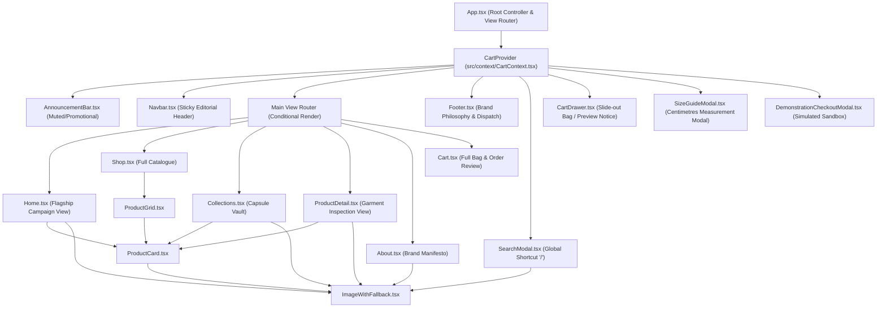
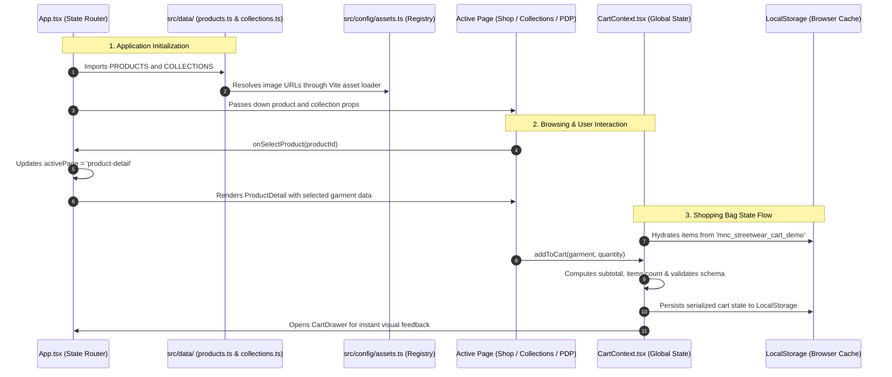
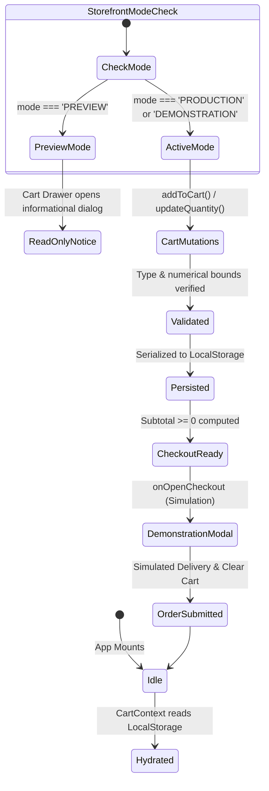

# MNC — APPLICATION ARCHITECTURE & DATA FLOW

---

## 1. ARCHITECTURAL OVERVIEW

MNC is engineered as a lean, responsive Single Page Application (SPA) built with **React 19**, **TypeScript**, **Vite**, and **Tailwind CSS v4**. It utilizes a decoupled, component-driven architecture designed to balance luxury editorial storytelling with e-commerce usability.

The application operates without an external routing library (such as `react-router-dom`), relying instead on a centralized state-driven view controller in `src/App.tsx`. This avoids client-side history desynchronization in prototype and embedded sandbox environments while keeping the production JavaScript bundle under 95 kB (gzipped).

---

## 2. COMPONENT HIERARCHY



---

## 3. DATA ARCHITECTURE & FLOW



---

## 4. NAVIGATION & VIEW ROUTING SYSTEM

The application uses an explicit, lightweight page controller managed in `src/App.tsx`:

- **Active View State**: `activePage: 'home' | 'shop' | 'collections' | 'product-detail' | 'about' | 'cart'`
- **Navigation Handler**: `handleNavigate(page: string, params?: { category?: string; collection?: string; productId?: string })`
- **Product Selection**: `handleSelectProduct(productId: string)` sets `selectedProductId` and switches `activePage` to `'product-detail'`.
- **Scroll Memory**: A `useEffect` hook triggers `window.scrollTo({ top: 0, behavior: 'smooth' })` on every route or product transition.
- **Global Search Shortcut**: A key listener mounts on `window` listening for `/` to immediately focus and open `SearchModal.tsx`.

---

## 5. PRODUCT & CATALOG ARCHITECTURE

### Data Models (`src/types/product.ts`)

```typescript
// Core Product Model
export interface Product {
  id: string;                                // e.g. 'mnc-001'
  name: string;                              // e.g. 'Core Hoodie – Black'
  slug: string;                              // e.g. 'core-hoodie-black'
  tagline?: string;                          // Editorial summary
  description: string;                       // Detailed garment narrative
  price: number;                             // Price in MYR (Ringgit)
  category: SellableProductCategory;         // 'Hoodies' | 'Tees' | 'Shirts' | 'Long Sleeves'
  collectionId: CollectionId;                // 'mnc-essentials' | 'mnc-season-001' | 'mnc-archive'
  collectionName: CollectionName;            // 'MNC ESSENTIALS' | 'MNC SEASON 001' | 'MNC ARCHIVE'
  availableSizes: ProductSize[];             // ['S', 'M', 'L', 'XL']
  availableColours: ProductColor[];          // Array of { name, hex }
  variants?: ProductVariant[];               // Phase 2 variant SKU structure
  imageSet?: ProductImageSet;                // Structured views (main, front, back, details, lifestyle)
  images: string[];                          // Array of resolved URLs
  stockCount: number;                        // Aggregate stock count
  featured: boolean;                         // Flag for homepage curation
  isNewArrival?: boolean;                    // Flag for new arrivals section
  fabricDetails: string[];                   // GSM, weave, knit, and construction notes
  fitGuide: string;                          // Boxy drape and length instructions
  sku: string;                               // Unique master catalogue SKU
}
```

### Central Asset Management (`src/config/assets.ts`)
To prevent broken asset references during builds, all static imagery is registered in `src/config/assets.ts` using Vite's modern URL resolution:

```typescript
new URL('../assets/images/core_hoodie_black_1793962769736.jpg', import.meta.url).href
```

All image rendering passes through `<ImageWithFallback />`, which implements:
1. Pulsing skeleton loader (`bg-[#E8E6DF] animate-pulse`).
2. Primary image render with `lazy` loading.
3. Fallback cascade to a clean architectural SVG placeholder displaying `MNC // ASSET PENDING` if images fail.

---

## 6. CART & CHECKOUT ARCHITECTURE



### Cart Data Model (`src/types/product.ts`)
```typescript
export interface CartItem {
  id: string;               // Unique compound key: `${productId}-${size}-${color.name}`
  productId: string;        // Parent product identifier
  name: string;             // Garment name
  price: number;            // Unit price in MYR
  size: ProductSize;        // Selected size (e.g. 'M')
  color: ProductColor;      // Selected color object
  quantity: number;         // Selected quantity (integer > 0)
  image: string;            // Primary thumbnail URL
  slug: string;             // Product slug for reverse navigation
}
```

### Storefront Configuration Gating (`src/config/storefront.config.ts`)
The cart system is governed by a central toggle:
- When `STOREFRONT_CONFIG.mode === 'PREVIEW'`, cart modifications are locked to prevent visitors from treating prototype data as real stock.
- When `STOREFRONT_CONFIG.mode === 'PRODUCTION'` or `DEMONSTRATION`, full `addToCart`, quantity modification, item removal, and checkout flows operate locally.
